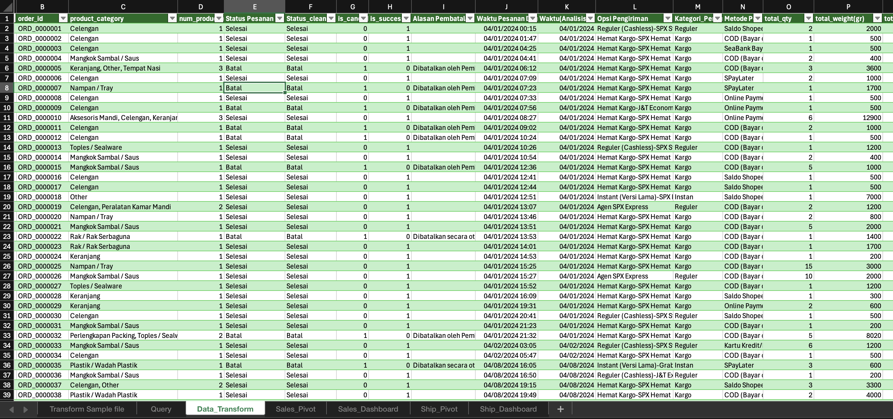

# E-Commerce Sales & Shipping Dashboard Indonesia (Excel)

The data is from Kaggle, *Indonesia E-Commerce Sales & Shipping 2023-2025*, and it has 24 files (probably one file per month). I combined all of them with total 24.000+ of rows, cleaned the data, and made 2 dashboards: Sales and Shipping.


Tools: Excel for Mac, Power Query, PivotTable, PivotChart, Slicer, Timeline.

## Start to clean

### 1. Prepare the folder

I put all the raw files in one folder first.


### 2. Load the folder into Power Query

On Mac, Excel can't connect to a folder directly, so I went through `Data > Get Data (Power Query) > Blank Query`. Then in the Advanced Editor I typed this:


It pulls in all the files that are inside the folder.

### 3. Combine files

After checking the data, I chose `Combine > Combine Files`. So the 24 files became one table. There is also a `Source.Name` column that shows the file name of each row (for example `AprilSales2024`). I use it again later.


### 4. Remove blank order_id

I checked again and some rows had an empty `order_id`, so I deleted them.

### 5. Group By

Before removing duplicates, I found something unusual: the same `order_id` appears more than once, and the total payment is also the same, etc. I think it's because one order has several products, so the rows got split. If I leave it like that, the values will be counted twice.

So I used `Home > Group By > Advanced`. The idea is to make it 1 row per order. Quantity and weight are summed up, and the product categories are joined into one text. Here is the setting and the code:


```m
Table.Group(
    #"Changed column type 1",
    {"Source.Name", "order_id", "Status Pesanan", "Alasan Pembatalan",
     "Opsi Pengiriman", "Waktu Pesanan Dibuat", "Metode Pembayaran",
     "Total Diskon", "Ongkos Kirim Dibayar oleh Pembeli",
     "Estimasi Potongan Biaya Pengiriman", "Total Pembayaran",
     "Perkiraan Ongkos Kirim", "Kota/Kabupaten", "Provinsi"},
    {
        {"total_qty", each List.Sum([Jumlah]), type nullable number},
        {"total_weight", each List.Sum([Total Berat]), type nullable number},
        {"total_returned_qty", each List.Sum([Returned quantity]), type nullable number},
        {"product_category",
            each Text.Combine(
                List.Sort(List.Distinct(List.RemoveNulls([product_category]))), ", "),
            type text}
    }
)
```

If I understand it correctly: the columns at the top are used to group the rows, and the ones at the bottom are summed up or joined.

After that I loaded it to Excel, and did the rest of the cleaning with normal Excel formulas.

### 6. Cleaning with formulas

I turned the data into a Table first (`Insert > Table`) so the formulas can use column names. If your Excel uses semicolons as separators, just change the commas.

**Weight.** It has the text " gr" in it (like `1200 gr`), so I removed it to make it a number:

```excel
=VALUE(SUBSTITUTE([@[Total Berat]]," gr",""))
```

**Total Pembayaran (total payment).** It has dots in it, so I removed them:

```excel
=VALUE(SUBSTITUTE([@[Total Pembayaran]],".",""))
```

**Shipping cost and shipping discount.** Some values were read as very small numbers (for example `8`, but it should be `8,000`), so if the value is below 1000 I multiply it by 1000:
(The reason is the pattern itself, that amount above 1000 they already intepreted it as Rupiah)

for potongan_pengiriman:

```excel
potongan_pengiriman:
=IF([@[Estimasi Potongan Biaya Pengiriman]]="","",
   IF([@[Estimasi Potongan Biaya Pengiriman]]<1000,
      [@[Estimasi Potongan Biaya Pengiriman]]*1000,
      [@[Estimasi Potongan Biaya Pengiriman]]))

```
For est_ongkir:

```excel
est_ongkir:
=IF([@[Perkiraan Ongkos Kirim]]="","",
   IF([@[Perkiraan Ongkos Kirim]]<1000,
      [@[Perkiraan Ongkos Kirim]]*1000,
      [@[Perkiraan Ongkos Kirim]]))
```

**is_cancelled.** If the status is "batal" (cancelled) it becomes 1, otherwise 0:

**is_success.** If the status is "batal" (cancelled) it becomes 0, otherwise 1:

```excel
=IF(LOWER(TRIM([@[Status Pesanan]]))="batal",1,0)
```

**ongkos_dibayar (shipping paid by the buyer).** Shipping cost minus the discount, but the minimum is 0 so it doesn't go negative. If the order is cancelled, it's 0:

```excel
=IF([@[is_cancelled]]=0,
   MAX(0,N([@[est_ongkir]])-N([@[potongan_pengiriman]])),
   0)
```

**tot_diskon (total discount).** Same problem as the shipping cost, some values were read as small numbers. If it has decimals I multiply by 1000 and round it. If the number is 1, 2, 3, 4, 5, 7, or 10 I leave it as it is, and the rest are multiplied by 1000:

```excel
=IF([@[Total Diskon]]="","",
   IF([@[Total Diskon]]<>INT([@[Total Diskon]]),
      ROUND([@[Total Diskon]]*1000,0),
      IF(ISNUMBER(MATCH([@[Total Diskon]],{1,2,3,4,5,7,10},0)),
         [@[Total Diskon]],
         [@[Total Diskon]]*1000)))
```

**Blank dates.** While checking more, I found that `Waktu Pesanan Dibuat` (order time) was empty for July and December. So I took the month and year from `Source.Name` (because the file name has it). The date becomes the 1st of the month, because only the month and year are available: (This is the best solution i can get, so i can retrieve the month and year to my data)

```excel
=IF([@[Waktu Pesanan Dibuat]]<>"",
   [@[Waktu Pesanan Dibuat]],
   DATE(MID([@[Source.Name]],FIND("Sales",[@[Source.Name]])+5,4),
        MATCH(LEFT([@[Source.Name]],3),
              {"jan","feb","mar","apr","may","jun","jul","aug","sep","oct","nov","dec"},0),
        1))
```

This works for file names like `JulySales2025`.

## Results:


## Dashboards

### Sales


Sales insights:
1. Online Payment has the highest cancellation rate (18.56%) and also the biggest total discount (around Rp5.6 million). So a big discount doesn't always stop people from cancelling. But this is only a correlation, I don't know the exact cause yet.
2. COD makes up about 55% of all cancellations (1,544 out of 2,833), even though its rate is only 13.37%. This is because it has the most orders. So if the goal is to reduce the number of cancellations, COD has the biggest impact.
3. Saldo ShopeePay has the lowest cancellation rate (8.74%), and its transaction value is quite big (around Rp240 million, almost the same as Online Payment).
4. The biggest transaction value is from COD, around Rp410 million, far above the other methods.
5. Payments are concentrated in Jawa Barat and Banten, far above the other provinces. Jawa Barat alone is roughly a quarter of the total.
6. The more product categories in one order, the higher the average payment tends to be. It peaks at 7-8 categories (around Rp185 thousand), then drops at 9. It might be a chance for bundling, but I can't say it always goes up.
7. Monthly trend: 2024 starts low (around Rp21-24 million at the beginning of the year), then rises sharply from July and peaks in September (around Rp71 million). 2025 actually starts high (around Rp53 million in January), drops to around Rp30 million in May-June, then goes up again until October.

### Shipping


Shipping insights:
1. Shipping is heavily subsidized. The shipping cost is around Rp306 million, the discount is around Rp222 million (about 72%), so buyers only pay around Rp85 million (28%).
2. The biggest subsidy is on Reguler (88.65%) and Hemat (88.04%). Kargo is 66.78% and Instan is 54.71%.
3. Kargo is the most dominant, 13,406 out of 20,423 orders (about 66%), followed by Reguler (about 27%). Instan, Hemat, and Nextday are very small.
4. Shipping gets more expensive when the package is heavier, and Reguler goes up the fastest. Hemat is the cheapest in every weight class.
5. Monthly trend: shipping payment in 2024 peaks around September, while 2025 goes down and is lowest around June. The pattern looks similar to the sales trend, so I can't say it's because of the subsidy.

## Limitations

- I calculated `Average Transaction Value` from all orders, including cancelled ones (their value is Rp0), so the number is probably lower than it should be.
- Categories with very few orders (Nextday, BCA OneKlik, etc.) are not used for conclusions, because the percentages can be confusing.
- The relationship between discount and cancellation is only a correlation, not necessarily cause and effect.
- I haven't analyzed the cancellation reasons and the return data yet, maybe in my next project.

## What I learned

Check the sample size first before showing percentages, and get to know the data first before making charts. It turns out I spent more time cleaning the data than making the dashboards.
