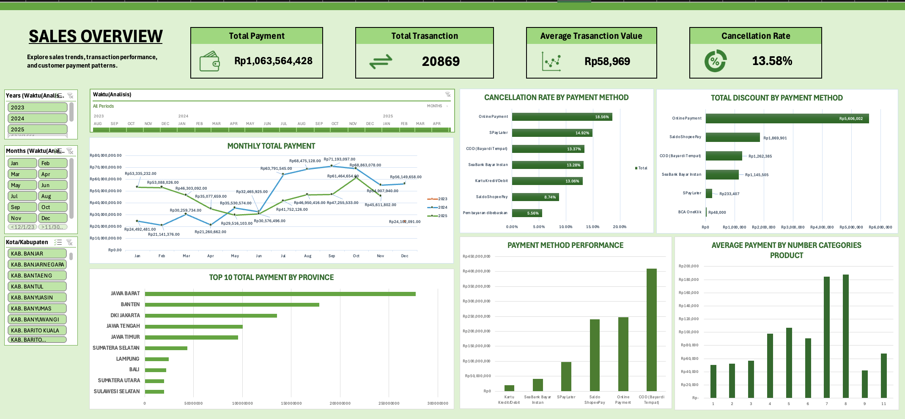
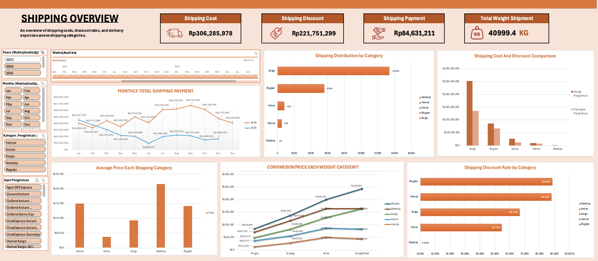
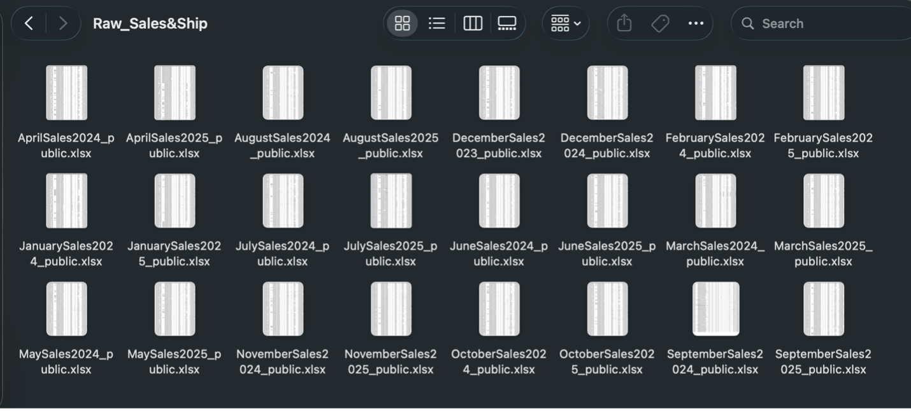
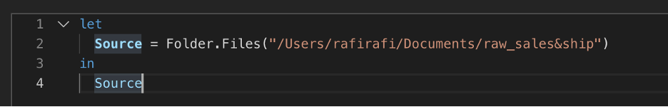
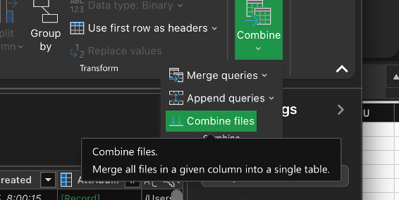
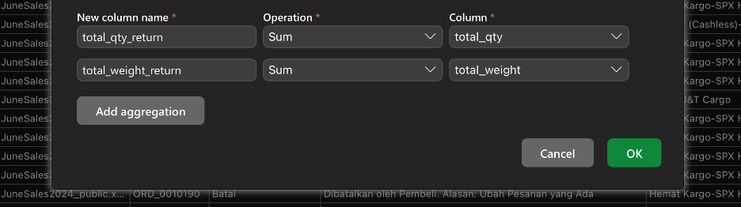

# Dashboard Sales & Shipping E-Commerce Indonesia (Excel)

Ini dashboard pertamaku di Excel. Datanya dari Kaggle, *Indonesia E-Commerce Sales & Shipping 2023-2025*, isinya 24 file (kayaknya satu file per bulan). Aku gabungin semuanya, bersihin, terus bikin 2 dashboard: Sales sama Shipping.




Tools: Excel for Mac, Power Query, PivotTable, PivotChart, Slicer, Timeline.

## Cara ngerjainnya

### 1. Siapin folder

Semua file mentah aku taruh di satu folder dulu.



### 2. Masukin folder ke Power Query

Di Mac ternyata nggak ada akses langsung ke folder, jadi aku lewat `Data > Get Data (Power Query) > Blank Query`. Terus di Advanced Editor aku tulis ini:



Fungsinya buat narik semua file yang ada di folder itu.

### 3. Combine files

Habis itu cek-cek datanya dulu, baru pilih `Combine > Combine Files`. Jadinya 24 file nyatu jadi satu tabel. Ada kolom `Source.Name` juga yang isinya nama file asalnya (contoh `AprilSales2024`), nanti kepake lagi.



### 4. Hapus order_id yang kosong

Cek-cek lagi, ada baris yang `order_id`-nya kosong, ya aku hapus.

### 5. Group By

Nah sebelum ke duplikat, ternyata ada kasus unik: ada `order_id` yang sama muncul beberapa kali, total pembayarannya juga sama, dll. Kayaknya itu karena 1 order isinya beberapa produk, jadi barisnya kepecah. Kalau dibiarin, nanti nilainya kehitung dobel.

Jadi aku pakai `Home > Group By > Advanced`, intinya biar jadi 1 baris per order. Qty sama berat dijumlahin, kategori produknya digabung jadi satu teks. Kodenya:



```m
Table.Group(
    #"Changed column type 1",
    {"Source.Name", "order_id", "Status Pesanan", "Alasan Pembatalan",
     "Opsi Pengiriman", "Waktu Pesanan Dibuat", "Metode Pembayaran",
     "Total Diskon", "Ongkos Kirim Dibayar oleh Pembeli",
     "Estimasi Potongan Biaya Pengiriman", "Total Pembayaran",
     "Perkiraan Ongkos Kirim", "Kota/Kabupaten", "Provinsi"},
    {
        {"total_qty", each List.Sum([Jumlah]), type nullable number},
        {"total_weight", each List.Sum([Total Berat]), type nullable number},
        {"total_returned_qty", each List.Sum([Returned quantity]), type nullable number},
        {"product_category",
            each Text.Combine(
                List.Sort(List.Distinct(List.RemoveNulls([product_category]))), ", "),
            type text}
    }
)
```

Kalau ga salah artinya: yang di atas itu kolom yang dijadiin patokan buat ngelompokin, yang di bawah itu kolom yang dijumlahin / digabung.

Abis itu aku load ke Excel, terus sisanya cleaning pakai rumus Excel biasa.

### 6. Cleaning pakai rumus

Tabelnya aku jadiin Table dulu (`Insert > Table`) biar rumusnya bisa pakai nama kolom. Kalau Excel kamu pemisahnya titik koma, ganti aja komanya.

**Berat.** Isinya ada tulisan " gr" (kayak `1200 gr`), jadi aku buang biar jadi angka:

```excel
=VALUE(SUBSTITUTE([@[Total Berat]]," gr",""))
```

**Total Pembayaran.** Ada titiknya, aku hapus:

```excel
=VALUE(SUBSTITUTE([@[Total Pembayaran]],".",""))
```

**Ongkir sama potongan ongkir.** Ada nilai yang kebaca kecil banget (misal `8`, padahal harusnya `8.000`), jadi kalau di bawah 1000 aku kali 1000:

```excel
potongan_pengiriman:
=IF([@[Estimasi Potongan Biaya Pengiriman]]="","",
   IF([@[Estimasi Potongan Biaya Pengiriman]]<1000,
      [@[Estimasi Potongan Biaya Pengiriman]]*1000,
      [@[Estimasi Potongan Biaya Pengiriman]]))

est_ongkir:
=IF([@[Perkiraan Ongkos Kirim]]="","",
   IF([@[Perkiraan Ongkos Kirim]]<1000,
      [@[Perkiraan Ongkos Kirim]]*1000,
      [@[Perkiraan Ongkos Kirim]]))
```

**is_cancelled.** Kalau statusnya "batal" jadi 1, selain itu 0:

```excel
=IF(LOWER(TRIM([@[Status Pesanan]]))="batal",1,0)
```

**ongkos_dibayar.** Ongkir dikurang potongan, tapi minimal 0 biar ga minus. Kalau ordernya batal ya 0:

```excel
=IF([@[is_cancelled]]=0,
   MAX(0,N([@[est_ongkir]])-N([@[potongan_pengiriman]])),
   0)
```

**tot_diskon.** Sama kayak ongkir, ada yang kebaca kecil. Kalau desimal dikali 1000 terus dibulatin, kalau angkanya 1, 2, 3, 4, 5, 7, atau 10 dibiarin, sisanya dikali 1000:

```excel
=IF([@[Total Diskon]]="","",
   IF([@[Total Diskon]]<>INT([@[Total Diskon]]),
      ROUND([@[Total Diskon]]*1000,0),
      IF(ISNUMBER(MATCH([@[Total Diskon]],{1,2,3,4,5,7,10},0)),
         [@[Total Diskon]],
         [@[Total Diskon]]*1000)))
```

**Tanggal yang kosong.** Pas lanjut ngecek, ternyata `Waktu Pesanan Dibuat` kosong di bulan Juli sama Desember. Akhirnya aku ambil bulan dan tahunnya dari `Source.Name` (kan ada nama filenya). Tanggalnya jadi tanggal 1 aja karena cuma bulan sama tahun yang ada:

```excel
=IF([@[Waktu Pesanan Dibuat]]<>"",
   [@[Waktu Pesanan Dibuat]],
   DATE(MID([@[Source.Name]],FIND("Sales",[@[Source.Name]])+5,4),
        MATCH(LEFT([@[Source.Name]],3),
              {"jan","feb","mar","apr","may","jun","jul","aug","sep","oct","nov","dec"},0),
        1))
```

Ini cocoknya buat nama file kayak `JulySales2025`.

## Dashboard

### Sales


Insight Sales:
1. Online Payment cancel rate-nya paling tinggi (18,56%) dan total diskonnya juga paling besar (sekitar Rp5,6 juta). Jadi diskon gede belum tentu bikin orang ga batal. Tapi ini baru korelasi, aku belum tau sebab pastinya.
2. COD nyumbang sekitar 55% dari semua pembatalan (1.544 dari 2.833), padahal rate-nya cuma 13,37%. Ini karena ordernya paling banyak. Jadi kalau mau nurunin jumlah pembatalan, COD yang paling berpengaruh.
3. Saldo ShopeePay paling jarang batal (8,74%), dan nilai transaksinya lumayan gede (sekitar Rp240 juta, hampir sama kayak Online Payment).
4. Nilai transaksi paling gede ada di COD, sekitar Rp410 juta, jauh di atas metode lain.
5. Pembayaran numpuk di Jawa Barat dan Banten, jauh di atas provinsi lain. Jawa Barat sendiri kira-kira seperempat dari total.
6. Makin banyak kategori produk dalam satu order, rata-rata pembayarannya cenderung makin tinggi, puncaknya di 7-8 kategori (sekitar Rp185 ribu), terus turun di 9. Mungkin bisa jadi peluang bundling, tapi ga bisa dibilang selalu naik.
7. Tren bulanan: 2024 mulai rendah (sekitar Rp21-24 juta di awal tahun), terus naik tajam dari Juli sampai puncak di September (sekitar Rp71 juta). 2025 malah mulai tinggi (sekitar Rp53 juta di Januari), turun sampai sekitar Rp30 juta di Mei-Juni, terus naik lagi sampai Oktober

### Shipping


Insight Shipping:
1. Ongkir disubsidi gede banget. Biaya ongkir sekitar Rp306 juta, potongannya sekitar Rp222 juta (kira-kira 72%), jadi pembeli cuma bayar sekitar Rp85 juta (28%).
2. Subsidi paling gede ada di Reguler (88,65%) dan Hemat (88,04%). Kargo 66,78%, Instan 54,71%.
3. Kargo paling dominan, 13.406 dari 20.423 order (sekitar 66%), disusul Reguler (sekitar 27%). Instan, Hemat, sama Nextday kecil banget.
4. Ongkir makin mahal kalau paketnya makin berat, dan Reguler kenaikannya paling tajam. Hemat paling murah di semua kelas berat.
5. Tren bulanan: pembayaran ongkir 2024 memuncak sekitar September, sedangkan 2025 turun dan paling rendah sekitar Juni. Polanya mirip tren penjualan, jadi belum bisa dibilang ini karena subsidi.

## Kekurangan

- `Average Transaction Value` aku hitung dari semua order, termasuk yang batal (nilainya Rp0), jadi angkanya kemungkinan lebih kecil dari yang seharusnya.
- Kategori yang ordernya dikit (Nextday, BCA OneKlik, dll) ga dijadiin kesimpulan, soalnya persentasenya bisa membingungkan.
- Hubungan diskon sama pembatalan itu cuma korelasi, belum tentu sebab-akibat.
- Alasan pembatalan sama data retur belum sempat aku analisis, mungkin di proyek berikutnya.

## Yang aku pelajari

Cek jumlah sampel dulu sebelum nampilin persentase, terus kenalan sama datanya dulu sebelum bikin chart. Ternyata lebih banyak waktu kepake buat bersihin data daripada bikin dashboard-nya.
